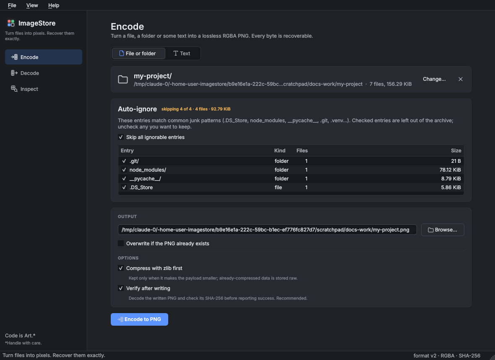
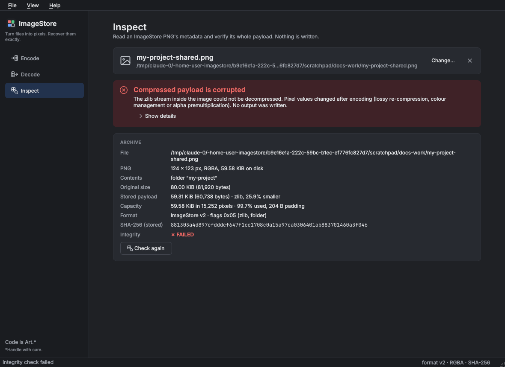
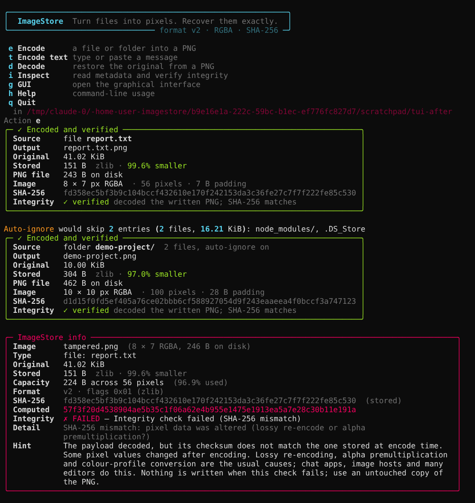

# ImageStore

> **ImageStore** — *Turn files into pixels. Recover them exactly.*
> **eXact** — *Edit what you intend. Preserve what you don't.*

Stash any file, folder or string inside an RGBA PNG. All four channels carry data (R, G, B
**and alpha**), so the image is a dense, lossless container for arbitrary bytes. Every
payload is protected by a SHA-256 digest, so a decode either returns exactly what you put
in or tells you it was altered.

This repository contains two tools:

| Directory | What it is |
|---|---|
| [`imagestore/`](imagestore/) | The encoder/decoder: a single-file Python CLI with an interactive menu, plus an optional graphical interface. |
| [`eXact/`](eXact/) | A binary-preserving PNG pixel editor, for editing ImageStore images without corrupting the payload. See its [README](eXact/README.md). |

## Installation

Python 3.8 or newer (developed on 3.14; the code uses the walrus operator and
`from __future__ import annotations`).

```bash
cd imagestore
python3 -m venv .venv
source .venv/bin/activate
pip install -r requirements.txt     # Pillow, rich: everything the command line needs
pip install -r requirements-gui.txt # optional: PyQt6 for the graphical interface
pip install -r requirements-numpy.txt # optional: NumPy, several times faster error correction
```

## Usage

```bash
python imagestore.py                          # interactive menu (file browser, prompts)

python imagestore.py encode report.pdf        # -> report.pdf.png
python imagestore.py encode ./my-folder       # folders are tarred first
python imagestore.py encode -t "some text"    # -> text.png
python imagestore.py decode report.pdf.png    # restores report.pdf next to the image
python imagestore.py info report.pdf.png      # metadata + integrity check (exit 1 if it fails)
python imagestore.py -g                       # graphical interface (optional, needs PyQt6)
```

The command line never starts the GUI on its own. Open it with `-g` / `--gui`, or with `g` in
the interactive menu. It has Encode, Decode and Inspect pages with drag-and-drop, progress
and cancellation, compression statistics, a reviewable list of auto-ignored folder entries,
and plain-language explanations when something fails.

Every encode is verified before it is reported as done: the PNG is written to a temporary
file next to the destination, decoded again, checked against its SHA-256 and only then
moved into place. `--no-verify` skips the check.

### Options

| Command | Flag | Effect |
|---|---|---|
| `encode` | `-o, --output PATH` | Output PNG (default `<file>.png`, or `text.png` with `-t`) |
| `encode` | `-t, --text TEXT` | Encode a string instead of a file |
| `encode` | `--no-compress` | Skip zlib/LZMA pre-compression |
| `encode` | `--window MiB` | Cap on the LZMA window, 1-1024 (default 64, rounded up to a power of two). Encoding needs about 7x this in RAM; a larger window only helps when repeats are far apart. The GUI has the same setting. |
| `encode` | `--ecc PERCENT` | Add error correction using about this much extra space, 0-50 (default 0, off). The image can then be repaired after damage to about half that share of it. The GUI has the same setting. |
| `encode` | `-f, --force` | Overwrite an existing output |
| `encode` | `--no-verify` | Skip decoding the written PNG to confirm it (faster, not recommended) |
| `encode` | `--auto-ignore` / `--no-auto-ignore` | Folders: skip (or keep) junk such as `.DS_Store`, `node_modules`, `__pycache__`, `.git`, `.venv`. By default it asks when run interactively and includes everything when scripted. |
| `decode` | `-o, --output-dir DIR` | Restore into `DIR` (default: next to the image) |
| `decode` | `-f, --force` | Overwrite existing output |
| *(none)* | `-g, --gui` | Open the graphical interface |

Text payloads are printed by `decode` instead of being written to a file. Decoded data is
only committed after the size and SHA-256 checks pass; folders are extracted into a staging
folder first, so a failed restore leaves nothing behind.

Errors go to stderr with a short explanation and a hint (for example *Integrity check
failed (SHA-256 mismatch)*, *Not an ImageStore image*, *Not enough disk space*), so piped
output such as decoded text is never mixed with messages. Exit codes: `0` success, `1`
error or failed integrity check, `130` interrupted.

## How it works

The image is a header followed by the (optionally compressed) payload, written
row-major into RGBA bytes. The image is made roughly square, and the unused tail is zero
padding.

```
>4s   magic          "IMST"
B     version        2
B     flags          0x01 zlib, 0x02 text, 0x04 folder (tar), 0x08 zero-run squeezed, 0x10 LZMA, 0x20 error correction
Q     original size
Q     stored size
32s   SHA-256 of the original bytes
H     name length
...   name (UTF-8)
...   payload
```

Encoding streams the source in 1 MiB chunks and keeps only the pixel buffer in memory.
The payload is stored raw, zlib-compressed or LZMA-compressed, whichever is smallest; compression is
used only when it actually makes the payload smaller. LZMA usually wins on text and source code
(about 25% smaller than zlib on a code folder) and costs a few times the CPU of zlib. Its window is sized from the original size (the next power
of two) and capped by `--window` (64 MiB by default), so repeats far apart in a large archive are
still found; encoding a large folder can use around 0.5 GB of RAM at the default, decoding far
less. The window is recorded as the first byte of an LZMA payload.
If your Python was built without the `lzma` module (it needs the xz development files), ImageStore
still runs: it compresses with zlib instead and reports a clear error for images that need LZMA.

Folders are tarred first, and tar pads every entry to a 512-byte block, so a folder with many
small files in nested subfolders is mostly zeros. zlib hides that, but when it is off (or does
not win) those zeros would become empty pixels. Folder payloads are therefore also *squeezed*:
each run of 8 or more zero bytes is replaced by its length (flag `0x08`), and whichever of
raw, zlib, LZMA and squeezed is smallest is stored. Images made before this change still decode.

Error correction (`--ecc`) is optional and off by default. It stores Reed-Solomon parity in the
pixels next to the data, in 255-byte blocks that are interleaved across the whole image, so a
stripe, a painted-over area or a wiped header costs each block only a few bytes. At 25% extra
space (64 parity bytes per block) an image still decodes after up to about 12.5% of it is
damaged, and the report says how many bytes were repaired. Parity is chosen in steps of 8 bytes
per block (about 3%), and the level is recognised again from the pixels, so no extra header
field is needed. The SHA-256 is still the final check: a repair that does not reproduce the
original is refused, never returned. Costs: the image grows by the percentage, encoding adds
roughly 0.1 s per MB, opening an error-corrected image reads all of it into memory, and
repairing damage takes a few seconds per MB. NumPy is optional: when it is installed the coder
runs across all blocks at once: for 4 MB at 25% parity, encoding takes 0.11 s instead of 0.68 s,
opening an intact image 0.10 s instead of 0.80 s, and repairing an image with every block
damaged 2.6 s instead of 26 s. Without it the
same code runs in plain Python, and `IMAGESTORE_NO_NUMPY=1` forces that. It cannot undo lossy re-encoding, which changes
every pixel slightly, and it does not help if so much is damaged that the image is no longer
recognised as an ImageStore image.

Folders also deduplicate: a file byte-identical to an earlier one (same size, same SHA-256)
is stored as a tar hard link to that file, with no data of its own. Decoding restores it as an
independent copy with its own timestamp and permissions, never as a real hard link. Links that
point outside the folder or at something that is not a file are refused.

## Caveats

- **The PNG must stay byte-exact at the pixel level.** Anything that re-encodes lossily,
  premultiplies alpha or strips the alpha channel breaks the digest. Many chat apps,
  image hosts and editors (macOS Preview included) do exactly that. If you need to edit
  an ImageStore PNG, use [eXact](eXact/README.md).
- The SHA-256 detects corruption; it is **not encryption**. Anyone with the PNG can decode
  it.
- The format is at version 2. Version 1 images (CRC32) are not readable.

## Sample

[`imagestore/imagestore.py.png`](imagestore/imagestore.py.png) is `imagestore.py` encoded
by itself. Check it with:

```bash
python imagestore.py info imagestore.py.png
python imagestore.py decode imagestore.py.png -o restored
```

It will go stale whenever the script changes, so re-encode it with
`python imagestore.py encode imagestore.py -f`. Archives made by earlier versions of the
script stay readable; `imagestore/tests/fixtures/legacy/` holds frozen examples that the
test suite decodes on every run.

## Screenshots

| | |
|---|---|
|  |  |
| eXact, Edit workspace: tool palette, exact RGBA pencil with per-channel write mask, pixel inspector next to original values, history. | eXact, Inspect workspace: hex bytes of the canonical buffer, integrity status. |
|  |  |
| ImageStore GUI: encoding a folder with the auto-ignore review. | ImageStore GUI: Inspect catches a modified archive. |



## Shared design

Both applications use the same dark-first visual language: colour tokens, a Qt stylesheet
and a HiDPI-safe SVG icon set live in one `style.py`, kept byte-identical in
`eXact/src/exact/gui/` and `imagestore/imagestore_gui/` (a test fails if they drift), so
each tool still installs and runs on its own.

*Code is Art.\** — *\*Handle with care.*
