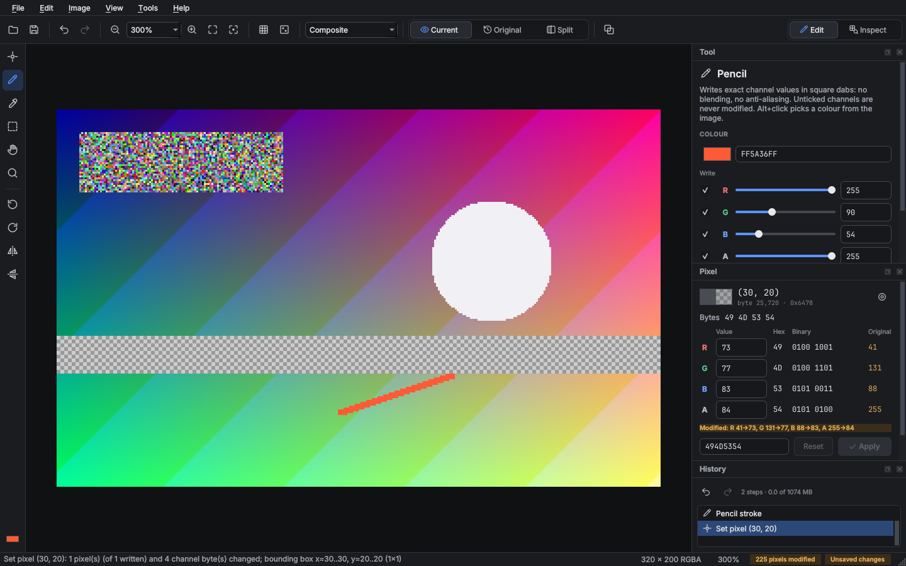
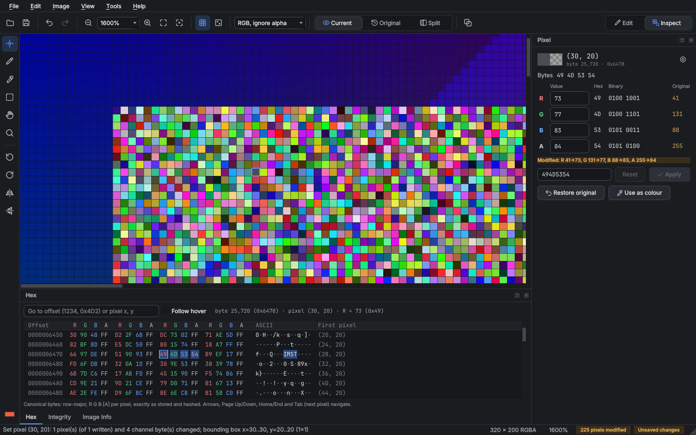
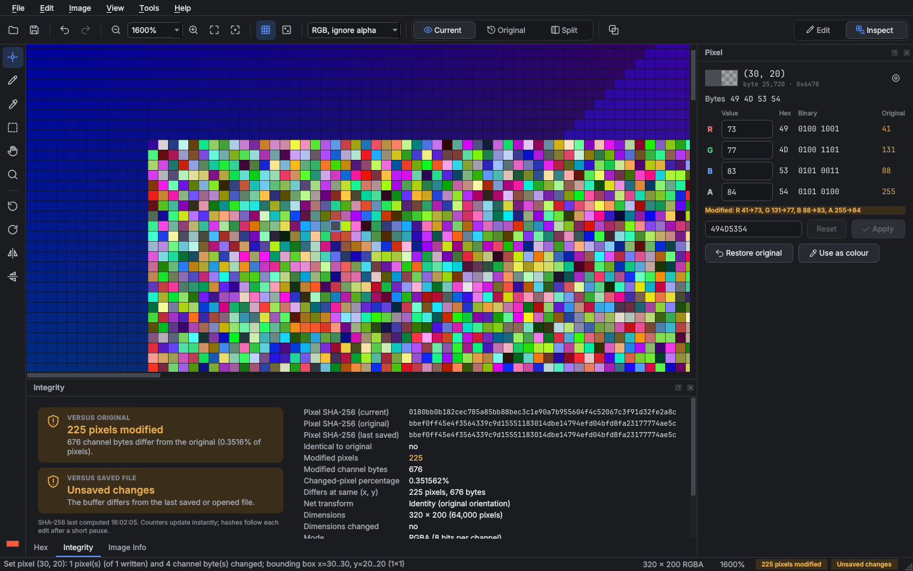
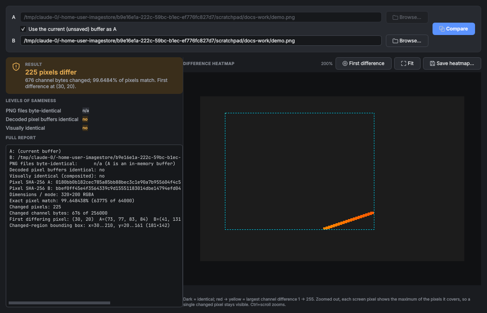

# eXact (eXtensible Accurate Color Toolkit)

> **Edit what you intend. Preserve what you don't.**

eXact is a binary-preserving pixel editor for PNG images. It is built for images whose
pixels *are data*: for example, [ImageStore](#background) PNGs, which store arbitrary files
in their RGBA channels together with binary headers and SHA-256 checks.

General-purpose editors such as macOS Preview can change pixels you never touched when
they save: they rewrite the RGB of transparent pixels, premultiply alpha, or apply
colour profiles. The image still *looks* the same, but every payload byte that changed
is now corrupt. eXact's core guarantee is that **every channel byte you did not
explicitly edit stays exactly as it was**, and every save proves it before your file is
touched.

eXact is not primarily a photo editor. Visual correctness is not enough; pixel
correctness is mandatory.

| Edit workspace | Inspect workspace |
|---|---|
|  |  |
| **Integrity panel** | **Compare dialog** |
|  |  |

---

## Contents

- [Installation](#installation)
- [Launching](#launching)
- [Using the editor](#using-the-editor)
- [Preservation guarantees](#preservation-guarantees)
- [How it works](#how-it-works)
- [Command-line tools](#command-line-tools)
- [Tests](#tests)
- [Performance (measured)](#performance-measured)
- [Limitations and unimplemented features](#limitations-and-unimplemented-features)
- [Project structure](#project-structure)

---

## Installation

You need Python **3.11 or newer**. eXact depends on PyQt6, Pillow and NumPy; pytest and
psutil are optional development dependencies.

```bash
git clone <this repo> eXact && cd eXact
python3 -m venv .venv
source .venv/bin/activate            # Windows: .venv\Scripts\activate
pip install -e '.[dev]'              # app + pytest/psutil
```

You can also install with `pip install -r requirements.txt` and run from the source tree
with `PYTHONPATH=src`.

## Launching

```bash
exact                       # GUI
exact path/to/image.png     # GUI, opening a file
python -m exact             # same, without the entry-point script
exact-cli --help            # command-line tools (see below)
```

You can also drag a PNG onto the window to open it.

---

## Using the editor

### Workspace

eXact is canvas-first: the image gets the space, and everything else sits in panels you
can resize, close, float or rearrange.

| Area | What it holds |
|---|---|
| **Toolbar** (top) | Open, Save, Undo/Redo (tooltips name the step), zoom out / level / in, fit, 100%, pixel grid, highlight changes, display mode, Current / Original / Split view with the split slider, Compare, the hazard-taped **Power Tools** section, and the **Edit / Inspect** workspace switch. |
| **Tool palette** (left) | Inspect, Pencil, Eyedropper, Rectangle Select, Hand and Zoom tools; rotate and flip; a chip showing the pencil colour. |
| **Canvas** (centre) | Nearest-neighbour view from 12.5% to 3200%, optional pixel grid at 400% and above, empty state with drag-and-drop. |
| **Tool** (right) | Properties of the active tool. Pencil: exact RGBA values (swatch, `RRGGBBAA`, a slider and number per channel) each with its own **write** toggle, and size. Select: the selection as editable x, y, w, h, plus copy, paste, fill and select-all. |
| **Pixel** (right) | The inspected pixel: coordinates, canonical byte offset, raw bytes, and each channel in decimal, hex and binary **next to its original value**. Edit any channel and press **Apply** (or Enter); **Restore original** writes the original values back; **Use as colour** copies them to the pencil. A line says whether the pixel matches the original, or exactly what changed. |
| **History** (right) | Every undoable step. Click an entry to undo or redo up to it; the saved state is marked; memory use against the 1 GiB budget. |
| **Hex** (bottom) | The whole canonical buffer, four pixels per row, bytes tinted by channel. Click a byte, or use the arrows, Page Up/Down, Home/End and Tab (next pixel); type an offset (`1234`, `0x4D2`) or `x, y` to jump. Follows the inspected pixel, or the mouse with *Follow hover*. |
| **Integrity** (bottom) | Whether the buffer matches the **original** and the **saved file**, every pixel hash and counter, and buttons to recompute hashes, copy a report or compare. |
| **Image Info** (bottom) | IHDR, interlacing, every chunk, tEXt entries and load notes (ICC/gAMA present but not applied, APNG, CRC errors, ...). |
| **Status bar** | Pixel under the cursor (coordinates and channel values), size and mode, zoom, and two always-visible chips: integrity versus the original, and versus the saved file. |

**Workspaces.** *Edit* (Ctrl+1) shows Tool, Pixel and History; *Inspect* (Ctrl+2) shows
Pixel, Hex, Integrity and Image Info and switches to the Inspect tool. Each workspace
remembers how you rearranged it; View > Reset Workspace Layout restores the default.
View > Theme switches between dark (default) and light.

**Integrity at a glance.** The status-bar chips update instantly after every operation from
exact incremental counters (no rescanning). A SHA-256 of the whole buffer then confirms the
state off the GUI thread, half a second after the last edit, never per brush movement.
"Matches saved file" is reported either because no edit happened since the save, or because
the hash shows the edits cancel out.

The **display mode** selector (composite over checkerboard, RGB ignoring alpha, alpha as
greyscale, single R/G/B channel), **Current / Original / Split** and **Highlight changed
pixels** are display-only: they never touch the buffer, which a test checks.

### Tools and shortcuts

On macOS, *Ctrl* below means *⌘*. Help > Keyboard Shortcuts (F1) lists them in the app.

| Action | Shortcut |
|---|---|
| Inspect / Pencil / Eyedropper / Rectangle select / Hand / Zoom tool | `I` / `P` / `E` / `M` / `H` / `Z` |
| Smaller / larger pencil | `[` / `]` |
| Edit / Inspect workspace | Ctrl + `1` / Ctrl + `2` |
| Pan | Space + drag, middle-drag, Hand tool, or scroll |
| Zoom in / out / 100% / fit | Ctrl + `=` / Ctrl + `-` / Ctrl + `0` / Ctrl + `9`, Ctrl + scroll, or the Zoom tool (Alt+click zooms out) |
| Pixel grid | Ctrl + `'` |
| Show original (before) | `\` |
| Highlight changed pixels | Ctrl + Shift + `H` |
| Pick pencil colour from image | Eyedropper tool, or Alt + click with the Pencil |
| Go to pixel… | Ctrl + `G` |
| Copy selection / Paste (click to place) / Paste at coordinates | Ctrl + `C` / Ctrl + `V` / Ctrl + Shift + `V` |
| Cancel paste placement | `Esc` or right-click |
| Fill selection with pencil colour | Ctrl + Backspace |
| Select all / Deselect | Ctrl + `A` / Ctrl + `D` |
| Rotate 90° CW / CCW | Ctrl + `R` / Ctrl + Shift + `R` (180° and flips are in the **Image** menu and the tool palette) |
| Undo / Redo | Ctrl + `Z` / Ctrl + Shift + `Z` |
| Compare two PNGs | Ctrl + Shift + `D` |
| Paint Bucket / Shapes (power tools) | `G` / `U` |
| Apply / discard a power-tool preview | `Enter` / `Esc` (on the canvas) |
| Constrain a shape to a square, circle or 45° line | Shift + drag |

**Pencil.** Set the colour in the Tool panel with exact `RRGGBBAA` hex values, the per-channel
sliders and numbers, the colour dialog, the Eyedropper, Alt+click, or *Use as colour* in the
Pixel panel. Sizes range from 1 to 64
pixels (square, no anti-aliasing). The **Write** toggle beside each channel is a write
mask: unticked channels are never modified. For example, you can rewrite only the alpha
channel of a region.

**Paste** writes raw channel values. If the clipboard and the image have different
channel counts, eXact explains what will happen and asks first:

- RGBA into RGB: the clipboard's alpha is dropped.
- RGB into RGBA: R, G and B are written and the destination alpha is left untouched.

The clipboard is internal to eXact, so you can copy between images you open in turn. It
is deliberately not the system clipboard, because other applications may convert the data.

**Rotations and flips** show a one-time notice. The transform preserves every value, but
pixel-order payloads will not decode until you apply the inverse.

### Power Tools

Everything above writes values you chose. **Power Tools** compute values instead, which is
exactly what eXact otherwise exists to prevent, so they are fenced off: a hazard-taped
section of the toolbar and a **Power Tools** menu of their own.

| Tool | What it does |
|---|---|
| **Paint Bucket** (`G`) | Fills with the pencil colour. A pixel matches when *every* channel, alpha included, is within ±tolerance (0–255) of the clicked pixel. Contiguous (4-connected) or global. |
| **Shapes** (`U`) | Line, rectangle or ellipse in the pencil colour; outline width 1–64 px (outlines grow inward) or filled. Aliased: every pixel is either written exactly or left alone. A line is the pencil's own Bresenham stroke. |
| **Gaussian Blur** | Radius 0.10–100 px in 0.01 px steps and strength 0–100 % in 0.1 % steps. Below 2 px an exact sampled kernel, above it three box passes (as in the SVG/CSS filter specifications). Integer arithmetic throughout, so the same settings give the same bytes on every machine. Reads neighbours beyond a selection; image edges are extended. |
| **Invert Colours** | 255 − v in each ticked channel. Its own inverse. |
| **Photo Nuker** | Deep-fries: saturation, contrast, posterisation, 4–16 px chroma blocks, grain and a warm tint, all scaled by *heat* (0–100 %). Never touches alpha. |
| **Cosmic Ray** | Flips N distinct random bits (seeded, reproducible) in the ticked channels. Useful for proving that an ImageStore checksum notices. |

Every destructive power tool has the same three controls:

- **Preview** computes the result into a separate array and draws it over the canvas. The
  buffer is not touched, so the integrity chips do not move, and only tiles under the
  preview are re-rendered. The toggle switches between the result and the untouched
  buffer. Bucket and shape previews follow the Tool panel: change the tolerance, stroke or
  colour and the same click or drag is recomputed.
- **Apply** (or Enter on the canvas) writes the result as one undoable step with exact
  accounting. Apply reuses the preview rather than computing it again. A preview computed
  from pixels that have since changed is discarded, never applied.
- **Undo** takes back the last power-tool step from the same panel or dialog.

The filters open in a modeless dialog, so you can still pan and zoom the canvas. It has a
300 % before/after magnifier that follows the pixel you inspect, the target (the selection,
or the whole image), per-channel toggles (prefilled from the pencil's write mask), and a
plain statement of how many pixels may change. A selection limits where every power tool
writes. Targets up to 2 MP re-preview live as you move a slider; larger ones preview on
demand behind the progress dialog.

**Memory.** The tools work in row bands and column strips of a few megabytes and never make
a float copy of the image. A whole-image filter allocates its result once, and that array
then becomes the redo half of the history step. Undo steps store whichever is smaller:
the coordinates of the painted pixels (thin shapes, sparse bit flips) or a copy of the
bounding box (dense fills, filters).

### Pixel-difference viewer

**File → Compare Pixel Buffers…** compares two PNG files, or the current unsaved
buffer against a file (drop files on the dialog to fill A and B). **File → Compare with File
on Disk** compares the buffer with the file it was opened from or last saved to. The dialog
leads with a verdict and the three levels of sameness, with the full text report below. The two images must have equal dimensions and mode. The report
shows:

- whether the PNG files are byte-identical, whether the decoded pixel buffers are
  identical, and whether the images are visually identical
- both pixel SHA-256 hashes
- exact match percentage, changed pixel count and changed channel-byte count
- the first differing coordinate, with both RGBA values
- the bounding box of the changed region
- a count of *invisible* changes: pixels that differ only in the RGB of fully transparent
  pixels

The heatmap is a zoomable view with the bounding box outlined. Dark means identical, and
changes run from red (difference of 1) to yellow (255). When zoomed out, each screen
pixel shows the *maximum* of the pixels it covers, so a single changed pixel never
disappears. Hovering shows A and B values side by side. You can also save the heatmap as
a PNG.

---

## Preservation guarantees

eXact keeps three notions of "the same" separate and never conflates them:

| Level | Meaning | How eXact measures it |
|---|---|---|
| **Byte-identical PNG files** | The same file bytes | SHA-256 of the file |
| **Identical decoded pixel buffers** | Every channel byte equal | SHA-256 and byte comparison of canonical bytes |
| **Visually identical** | Equal after compositing over any background | Differs from the row above only when the RGB of fully transparent pixels changed, which is exactly the damage lossy editors do |

### Guaranteed

1. **Untouched pixels keep their exact R, G, B and A bytes.** All edits *replace* values in
   the pixels you target. eXact never blends, composites, premultiplies, colour-manages,
   gamma-corrects, resizes or normalises. Writing into a transparent pixel changes only
   that pixel's selected channels and nothing around it.
2. **No silent mode conversion.** RGB stays RGB and RGBA stays RGBA. eXact never adds or
   drops an alpha channel.
3. **Transforms are pure permutations.** Rotate 90° CW/CCW, rotate 180° and both flips
   move whole pixels; the inverse transform restores the original buffer byte for byte.
   Tests cover all three-step sequences of these transforms.
4. **Every save is verified before it can do harm.** eXact writes the file to a temporary
   file in the destination directory. It then re-parses that file, decodes it with an
   independent decoder (Pillow), and compares the result byte for byte with the intended
   buffer. Only after that does it atomically replace the destination with `os.replace`.
   If anything fails, the original file is not modified and the temporary file is
   removed.
5. **Exact accounting.** Each operation reports the exact number of pixels and channel
   bytes it changed and their bounding box. The integrity counters are maintained
   incrementally, and tests check them against full rescans.
6. **Unsupported formats are refused, not converted.** This covers 16-bit, greyscale,
   greyscale+alpha and palette PNGs. eXact checks IHDR *before* decoding, because Pillow
   would otherwise silently truncate 16-bit RGB to 8-bit.

### Not guaranteed

- **Byte-identical PNG files.** eXact re-compresses on save, so file size and file SHA-256
  normally change even when every pixel byte is identical. Saving an unchanged document
  over its own file is skipped entirely ("Nothing to save").
- **Decodability of a payload after a rotation or flip.** The values are intact but in a
  different order. Apply the inverse transform before decoding.
- **Some file data** is listed before saving and needs your confirmation; see the
  metadata policy below.

### Metadata policy on save

| Chunk(s) | Action |
|---|---|
| IHDR, IDAT, IEND | Regenerated from the buffer: 8-bit, original colour type, non-interlaced |
| tEXt, zTXt, iTXt, iCCP, sRGB, gAMA, cHRM, cICP, mDCV, cLLI, sBIT, bKGD, tRNS, hIST, sPLT, eXIf, PLTE (suggested palette) | Preserved byte for byte, in their original position before or after IDAT |
| pHYs | Preserved; X and Y density are swapped after a 90° rotation |
| tIME | Preserved if the pixels are unchanged, otherwise set to now (UTC) |
| eXIf after a 90° rotation | Preserved, but EXIF orientation and dimension tags are **not** rewritten |
| Unknown safe-to-copy chunks (lowercase 4th letter) | Preserved |
| Unknown unsafe-to-copy chunks | Preserved only if the pixel data is unchanged; otherwise dropped, as the PNG specification requires |
| APNG (acTL / fcTL / fdAT), dSIG, bytes after IEND | Dropped. eXact lists them and asks for confirmation before saving |
| Adam7 interlacing | Not preserved; output is non-interlaced. Pixel values are unaffected |

Colour-interpretation chunks (iCCP, gAMA and the like) are **never applied**: the canvas
always shows raw channel values.

---

## How it works

### Canonical pixel buffer

The only authoritative image data is a NumPy `uint8` array of shape `(height, width,
channels)`:

- C-contiguous and row-major, with row 0 at the top
- channel order `R, G, B` for RGB images and `R, G, B, A` for RGBA
- straight (non-premultiplied) alpha, exactly as stored in the PNG

The byte offset of pixel `(x, y)`, channel `c`, is `(y * width + x) * channels + c`. All
pixel hashes are SHA-256 over these canonical bytes. They are not computed over the PNG
file, and dimensions and mode are reported separately rather than hashed.

eXact also keeps an immutable copy of the buffer as loaded. Before/after views and the
"modified" counters compare against that copy, mapped through the net rotate/flip, which
eXact tracks as an element of the dihedral group D4. This means "modified pixels" counts
value edits only, while "differs at same (x, y)" is the plain positional comparison.

### Loading

1. eXact parses the PNG chunk structure itself, validating every CRC and hashing the file
   bytes.
2. It accepts only 8-bit colour type 2 (RGB) or 6 (RGBA).
3. Pillow decodes the image, which eXact copies in horizontal strips straight into the
   canonical buffer.
4. Pillow's block size is raised so that its decode buffer is one allocation. macOS
   returns it to the OS when it is freed; with Pillow's default 16 MiB blocks, about
   225 MB stayed resident.

### Display: viewport tiling

Qt never holds authoritative pixels:

- The canvas renders **256×256 display tiles**. Each tile is a throwaway, opaque RGB array
  produced by slicing the visible region of the buffer, so Qt never sees alpha and
  premultiplied formats can never touch real pixels.
- Tiles are drawn with nearest-neighbour scaling and kept in a 96 MB LRU cache, keyed by
  the display settings (display mode, before/after mode, highlight, checker size and zoom
  step).
- When pixels change, the Document notifies listeners with the **dirty rectangle**. Only
  tiles that intersect it are discarded, while scrolling and hover repaints become blits
  of cached tiles.

### Editing and undo

- Commands store only what changed:
  - **Sparse patches:** coordinates plus before/after values, for pencil strokes and
    single-pixel edits.
  - **Rectangle patches:** before/after copies, for fills and pastes.
  - **Transforms:** the operation name only, since undo applies the exact inverse.
- No operation ever snapshots the whole image.
- History has a 1 GiB budget, after which the oldest steps are dropped.

### Saving: dirty row-bands

eXact writes IDAT itself:

- **Bands.** The image is split into row-bands of about 4 MiB. Each band gets adaptive
  PNG filtering (filter type chosen per row by the specification's minimum-sum heuristic,
  scored on sampled column spans) and is deflated in parallel threads.
- **Stitching.** Each band is an independent raw-deflate segment that ends in a sync
  flush. The segments concatenate into one valid zlib stream, and their Adler-32 values
  are merged with a port of zlib's `adler32_combine`.
- **Dirty-band reuse.** The Document records which **rows have been dirtied** since the
  last save. On the next save, bands whose rows (and the row above them) are clean are
  copied verbatim from the previously written file, which acts as an on-disk cache and
  costs no extra RAM. Only dirty bands are re-encoded. A test asserts that the result is
  byte-identical to a full re-encode.
- **Safety net.** The cache is used only if the file's inode, size and mtime still match.
  The full decode verification still runs on every save, and if a reused band ever failed
  verification, eXact retries with a full encode.

---

## Command-line tools

```bash
exact-cli info image.png                  # IHDR, chunks, warnings, pixel and file SHA-256
exact-cli hash image.png                  # pixel SHA-256 and file SHA-256
exact-cli compare a.png b.png [--heatmap diff.png]   # exit 0 identical, 1 differ, 2 incomparable
exact-cli roundtrip image.png             # verified save to a temp file, then compare
exact-cli make-test-image out.png --size 7488x7487 --mode RGBA --seed 921
```

`make-test-image` writes a deterministic image that resembles a binary payload: random
bytes in every channel, an `IMGSTORE` header holding the SHA-256 of the body, a band of
alpha=0 pixels with non-zero RGB, and so on.

---

## Tests

```bash
python -m pytest            # 115 tests, about 45–60 s (GUI tests run headless with QT_QPA_PLATFORM=offscreen)
python -m pytest --runslow  # adds 7488×7487 full-size tests (118 total)
```

The tests cover:

- RGBA and RGB round trips
- load → save without edits producing identical raw bytes
- transparent pixels with non-zero RGB
- arbitrary binary data in all four channels
- alpha preservation with no premultiplication
- refusal of 16-bit, greyscale, grey+alpha and palette images
- one-pixel edits that change exactly one pixel, and preservation of untouched pixels
  (including next to transparent pixels)
- pencil lines touching only line pixels, and the channel write mask
- undo/redo accuracy across mixed operations
- incremental counters checked against full rescans over 60 random operations
- every transform and its inverse, D4 composition, and pure-permutation checks
- failed-save protection: injected verification failure and injected I/O error both
  leave the original byte-identical with no temporary file left behind
- permission preservation and SHA-256 over canonical bytes
- metadata preservation and dropping rules, including the pHYs swap
- RGB+tRNS and Adam7-interlaced sources
- dirty-band reuse: byte-identical to a full encode, correct invalidation across band
  boundaries, after undo and after transforms, corrupt-cache fallback, and a cache
  ignored when the file changed on disk
- the diff engine
- a headless GUI suite on the Qt offscreen platform: real mouse events drive the pencil,
  transforms run through the window, saved output is checked, the inspector and hex
  panel are exercised, and screen pixels are checked after edit, undo and transform to
  confirm tile invalidation
- the redesigned workspace (`tests/test_gui_workspace.py`): every view mode, zoom,
  workspace and theme leaves the buffer byte-identical and a no-op save is exact (RGB under
  alpha 0 included); single-channel edits and *Restore original* through the Pixel panel;
  the Tool panel's write mask (alpha-only pencil leaves RGB untouched); Eyedropper and Zoom
  tools never write; History jumps; transform round trips; hex keyboard, mouse and go-to
  navigation; workspace presets and their memory; off-thread SHA-256 confirmation and no
  hashing during a brush stroke; tile eviction never losing unsaved edits; compare dialog;
  error explanations; cancellable open (state unchanged) while save and transforms are never
  cancellable; a 3000×2000 navigation test and a 7488×7487 one under `--runslow`
- power tools (`tests/test_power.py`): the blur against a float64 Gaussian, banding that
  never changes the result, a blurred selection equal to the same area of a whole-image
  blur, no overflow at the largest radius; outlines thin, closed and inside the fill; a
  line identical to a pencil stroke; flood fill against brute force; invert twice is
  identity; nuker crops equal to the full result and alpha untouched; exactly N bits
  flipped; counters checked against full rescans across apply, undo and redo; and in the
  window, every tool's Preview leaves the buffer and generation untouched, Apply reuses
  the preview, Undo restores every byte, and a stale preview is never applied
- the **final acceptance test**

**Final acceptance test** (`tests/test_acceptance.py`):

1. Create an image with arbitrary binary RGBA values and open it.
2. Rotate 90° CW, save, and reopen.
3. Rotate 90° CCW and save again.
4. Check that the final buffer equals the initial one by both SHA-256 and direct byte
   comparison.
5. Edit one pixel, save, and check that exactly one pixel differs.

The suite passes on Python 3.14.2 and 3.11.

---

## Performance (measured)

### Original measurements (macOS)

Measured with `python scripts/benchmark.py`, using a 7488×7487 RGBA PNG of random bytes
(224 MB raw, 224 MB as PNG, since random data does not compress). Each scenario runs in a
fresh process, and peak RSS is `ru_maxrss` for that process.

**Machine:** MacBook with Intel Core i5-1030NG7 (1.1 GHz, 4 cores), 16 GB RAM, macOS
15.8.2, Python 3.14.2, PyQt6 6.10.1, Pillow 12.1.0, NumPy 2.4.2. This CPU throttles
heavily, so times are given as the range over three uncontended runs.

| Scenario | Peak RSS | Time |
|---|---|---|
| Open (decode + verify structure + baseline copy + hash) | 507 MB | 1.7–3.0 s |
| Rotate 90° CW, then CCW (hash checked equal) | 717 MB | 0.8–3.0 s per rotation |
| Full verified save (encode + fsync + full decode + byte compare + atomic replace) | 756 MB | 7.0–9.4 s |
| Verified save after a 1-pixel edit (53 of 54 bands reused) | 756 MB | 3.2–5.0 s |
| Pencil stroke, 21,990 pixels (size 4) | – | 0.11–0.26 s |
| SHA-256 of the pixel buffer | – | 0.21–0.50 s |
| GUI: open + paint a 1600×1000 window | 581 MB | – |
| Paint: cold tiles / cached / after a 64 px scroll | – | 63–110 ms / 3–15 ms / 2–36 ms |

### Before and after the workspace redesign (Linux)

Same benchmark, run twice before the redesign and twice after, on a shared 4-vCPU cloud VM
(Intel Xeon @ 2.8 GHz, 16 GB, Linux 6.18, Python 3.13.17, PyQt6 6.11.0, Pillow 13.0.0,
NumPy 2.5.4, Qt offscreen platform). The VM is noisy: ranges are min–max of the two runs.

| Scenario | Peak RSS before → after | Time before | Time after |
|---|---|---|---|
| Open (every `open=` timing across the scenarios) | 503–504 → 503–504 MB | 3.1–6.4 s | 3.9–6.4 s |
| Rotate 90° CW / CCW | 699 → 699 MB | 2.9–3.6 s / 1.4–1.5 s | 4.1 s / 1.8–1.9 s |
| Full verified save | 807–811 → 806–808 MB | 9.8–10.9 s | 9.6–10.3 s |
| Verified save after a 1-pixel edit (53/54 bands reused) | – | 6.8–6.9 s | 7.4–7.9 s |
| Pencil stroke, 21,990 pixels | – | 0.10–0.12 s | 0.10–0.13 s |
| SHA-256 of the buffer | – | 0.59–0.80 s | 0.65–0.80 s |
| GUI process (open + window + paint) | 534 → 535 MB | – | – |

The core code is unchanged, so differences in the rows above are run-to-run noise on the
shared VM (`open` covers the same decode; see also the next table). The window
benchmark's paint figures are not comparable before/after because the Edit workspace gives
the canvas a larger viewport than the old layout (no bottom dock, narrower right dock). On
an identical 1184×784 canvas viewport (`EditorCanvas` alone, same image, five positions,
medians of two runs each):

| Canvas paint, 1184×784, 100% | Before | After |
|---|---|---|
| Cold (tile cache cleared) | 48.8–50.5 ms | 50.0–61.4 ms |
| Cached | 4.0–4.4 ms | 4.7 ms |
| After a 64 px scroll | 4.3–5.3 ms | 4.3–4.7 ms |
| Zoom 100% → 200% | 22.7–29.9 ms | 27.5–31.2 ms |

New interactions in the redesigned window (`ui` scenario, 7488×7487, 1600×1000 window,
two runs):

| Interaction | Time |
|---|---|
| Hover readout (status bar) | 0.01 ms |
| Inspect a pixel (Pixel panel + hex view) | 0.87–0.90 ms |
| Hex view repaint | 5.1 ms |
| Jump hex view to the last byte | 0.85–1.1 ms |
| Pencil: one mouse move + full-viewport repaint at 400% (mean / max over 200 moves) | 11.1–11.3 / 21.8–25.3 ms |
| Pencil: release (records the undo step, refreshes panels) | 8.3–9.4 ms |
| Full-buffer SHA-256 runs started during a 200-move stroke | 0 |
| Release to SHA-256-confirmed status (includes the 0.5 s debounce, off-thread) | 1.17–1.22 s |
| Apply a one-pixel edit from the Pixel panel | 4.1–5.4 ms |
| Refresh every panel after an edit, 522-step history | 4.5–4.6 ms (was 21.6 ms before the History panel became incremental) |
| Switch workspace | 16–18 ms |
| Peak RSS of the GUI process | 550 MB |

`python scripts/benchmark.py --size 1024x1024` runs the same scenarios on a small image.

### Power Tools (macOS)

7488×7487 RGBA payload image, same MacBook as above, each scenario in a fresh process. The
CPU sat at 99–101 °C throughout (heavily throttled), so treat these as single runs on a
hot machine rather than best cases. Image plus immutable original is 458 MB of the RSS.

| Operation (whole image unless noted) | Time | Peak RSS |
|---|---|---|
| Gaussian blur, 1.5 px (exact kernel) | 8.6 s | 740 MB |
| Gaussian blur, 3 px (box passes), 1 thread → 4 threads | 23.7 s → 14.2 s | 919 → 924 MB |
| Gaussian blur, 100 px | 20.0 s | 752 MB |
| Apply / undo a whole-image result (exact accounting) | 1.0–1.2 s / 0.6–0.7 s (were 6.6 s / 7.2 s before banded `uint32` change detection) | – |
| Photo Nuker, 70 %, 1 → 4 threads | 9.7 s → 8.6 s | 690–738 MB |
| Invert RGB (+ apply 0.64 s, undo 0.50 s) | 0.43 s | 894 MB with history |
| Cosmic ray, 1,000,000 bits | 0.88 s | 575 MB |
| Paint bucket, contiguous, 15,000,000-pixel region (+ apply 0.32 s) | 1.22 s | 654 MB |
| Paint bucket, global | 2.18 s | 514 MB |
| Ellipse outline, 7201 px across, 8 px stroke (221,740 pixels; + apply 0.28 s, 5 MB of history) | 0.04 s | 80 MB process total (on a 1 MP image) |
| Canvas, 1184×784 at 100 %: first paint with a preview / cached / after discard | 40–46 ms / 3–4 ms / 33–42 ms | – |

Whole-image filters on images this size run behind the progress dialog. Zoomed in, the
preview covers only the visible part of the target and stays live while you drag sliders;
Apply then computes the whole target.

**Expected memory:** the buffer (224 MB) plus the immutable original (224 MB) plus about
60 MB of runtime. Rotation briefly needs a second buffer, and save verification needs
the decoder's copy. The hex view, inspector and integrity panels read the buffer in place
(no copies); the tile cache is capped at 96 MB of display tiles.

**Before the tiling and dirty-band work**, the same full save took 45 s, opening peaked at
706 MB and rotation at 930 MB.

---

## Limitations and unimplemented features

These are not implemented in v0.1.0:

- **Formats:** only 8-bit RGB and 8-bit RGBA PNGs. 16-bit, greyscale, palette, JPEG and
  other formats are refused with an explanation.
- **APNG:** only the default image is edited; animation frames are dropped on save after
  confirmation.
- **Annotation tools:** there is no text tool, and shapes are aliased only (no
  anti-aliasing, by design). Shapes cannot be edited after you apply them.
- **Power-tool previews below 100% zoom** show sampled pixels like the rest of the canvas,
  so scattered Cosmic Ray flips may not be visible until you zoom in (the dialog's
  magnifier always shows them).
- **Selections:** a selection cannot be moved by dragging (paste is placed by click or by
  coordinates). There is no crop or resize, since those change dimensions.
- **System clipboard:** eXact uses an internal clipboard only, by design.
- **One document per window.**
- **EXIF:** orientation and dimension tags are not rewritten after rotation.
- **File-system metadata:** an atomic replace creates a new inode, so macOS extended
  attributes, Finder tags and hard links to the old file are not carried over. POSIX
  permission bits are copied. Symlinks are resolved and their target is replaced.
- **Colour-managed display:** not provided, intentionally. The canvas shows raw values.
- **Zoomed-out display:** below 100% the editor canvas shows sampled pixels, so a single
  edited pixel may not be visible. The difference heatmap max-pools instead.
- **Platforms:** developed on macOS; the test suite and benchmarks also run on Linux
  (headless). The code uses only portable APIs (`os.replace`, Qt, NumPy and Pillow; the
  directory fsync is skipped on Windows), but it has **not been run on Windows**.
- **GUI testing:** the GUI is tested headlessly (offscreen Qt with synthetic mouse and key
  events) on macOS and Linux and was checked visually from offscreen screenshots. The
  redesigned workspace has not been exercised by hand on a physical display, a
  screen reader, or a fractional-scale (e.g. 150%) HiDPI screen.
- **Themes:** switching theme restyles everything immediately except colours baked into a
  few already-open dialogs.

---

## Project structure

```
eXact/
├── pyproject.toml / requirements.txt
├── src/exact/
│   ├── __main__.py           # python -m exact
│   ├── cli.py                # exact-cli
│   ├── core/                 # Qt-free, fully unit-tested
│   │   ├── pixels.py         # canonical buffer conventions, SHA-256
│   │   ├── png_chunks.py     # chunk parsing/writing, CRC, IHDR
│   │   ├── png_io.py         # strict load, banded encoder, verified atomic save
│   │   ├── transforms.py     # rotations/flips, D4 orientation tracking
│   │   ├── history.py        # patch-based undo/redo
│   │   ├── document.py       # the editable document, dirty tracking
│   │   ├── diff.py           # raw buffer / file comparison
│   │   ├── power.py          # power tools: bucket, shapes, blur, invert, nuker, cosmic ray
│   │   └── synthetic.py      # deterministic payload-like test images
│   └── gui/                  # PyQt6
│       ├── app.py            # entry point, theme
│       ├── main_window.py    # workspace layout, actions, workspaces, save/open flows
│       ├── canvas.py         # tiled zoom/pan view, tools, tile cache
│       ├── display.py        # display-only conversions (composite, channels, heatmap)
│       ├── panels.py         # tool properties, pixel inspector, integrity, history, info
│       ├── power_tools.py    # Power Tools section, previews, filter dialog
│       ├── hexview.py        # virtual hex view of the canonical buffer
│       ├── diff_dialog.py    # pixel-difference viewer
│       ├── errors.py         # plain-language error explanations
│       ├── style.py          # shared design tokens, stylesheet, SVG icons (same file in ImageStore)
│       └── tasks.py          # background work behind a modal progress dialog
├── tests/                    # pytest suite (see above)
└── scripts/benchmark.py      # peak-RSS / timing benchmark
```

---

## Background

ImageStore is a Python application that encodes arbitrary files, folders, source code
and databases into RGBA PNG images, storing the binary data directly in pixel channels.
Any change to a single byte breaks its headers and SHA-256 integrity checks, which is
why eXact exists.

**Official motto:** *Code is art. Handle with care.*

**Unofficial motto:** *Unlike Preview, we don't touch your fucking bytes.*
